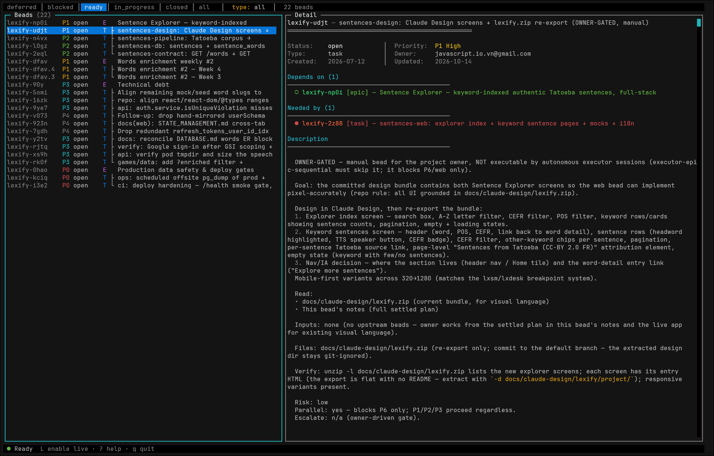

# bdtui

Fast blessed-based terminal UI for the [`bd`](https://github.com/gastownhall/beads) beads issue tracker.



## Requirements

- Node ≥ 20
- `bd` installed and on `$PATH`
- A project with a `.beads/` database (created by `bd init`)
- (Optional) A clipboard helper for the `y` yank key:
  - Linux/Wayland: `wl-clipboard` (`sudo apt install wl-clipboard`)
  - Linux/X11: `xclip` (`sudo apt install xclip`) or `xsel`
  - macOS: `pbcopy` (preinstalled)
  - Windows: `clip.exe` (preinstalled on Windows 10/11)

## Install

First install `bd`:

```bash
brew install beads          # macOS / Linux
npm install -g @beads/bd    # via Node.js
```

Then install bdtui:

```bash
npm install -g bdtui
```

## Usage

```bash
bdtui              # use current directory
bdtui .            # explicit current directory
bdtui ~/www/myapp  # explicit project path
```

The list refreshes automatically (the status bar shows `⟳ live`) when another process changes a bead, using the Beads events journal: needs Beads ≥ 1.3.0 and the journal turned on (`bd config set events-journal true`, or press `Shift+l` in bdtui when it offers to). Otherwise press `r` to reload. To turn live refresh off for the current session, press `Shift+l` or click `⟳ live`; the same key or a click on `⟳ live off` turns it back on.

## Layout

A top tab bar (the active status filter is highlighted — shown here as `[ready]` — followed by the live `type:` / `epic:` / `search:` and bead-count indicators), a two-pane body with the **Beads** list on the left and the **Detail** view on the right, and a bottom status bar. The tabs, the indicators and the status-bar hints are clickable (see [Mouse](#mouse)):

```
┌──────────────────────────────────────────────────────────────────────────────────
│ deferred │ blocked │ [ready] │ in_progress │ closed │ all   type: all · 27 beads
├──────────────────────────────────────────────────────────────────────────────────
│ Beads (27)                        │ Detail
│ be-12 P1 in_prog T Fix login      │ be-12 — Fix login bug
│ be-13 P2 open    T Retry          │ ══════════════════════════════
│ be-10 P1 open    E Auth epic      │ Status:  in_progress  │ Priority: P1 High
│ be-11 P2 open    T ├ OAuth        │ Type:    bug          │ Owner:    alice
│ be-14 P2 closed  B └ CSRF         │ Created: 2026-06-01   │ Updated:  2026-06-14
│                                   │
│ list · 40%                        │ detail · 60%
├───────────────────────────────────────────────────────────────────────────────────
│ ● Ready   ? help · q quit
└───────────────────────────────────────────────────────────────────────────────────
```

Each list row reads `id · priority · status · type-badge · title`. The detail pane shows the selected bead's fields, its close reason (for closed beads), dependencies, and rendered description.

Beads with parent–child dependencies are shown as a tree inside the active filter — child rows nest under their epic with `├` / `└`:

```
be-10 P1 open    E Auth epic
be-11 P2 open    T ├ Add OAuth login
be-12 P2 open    T └ Refresh tokens
```

## Keybindings

| Key                 | Action                                                                                                                                                                                                                                                                                                                                                        |
| ------------------- | ------------------------------------------------------------------------------------------------------------------------------------------------------------------------------------------------------------------------------------------------------------------------------------------------------------------------------------------------------------- |
| `j` / `↓`           | Move down                                                                                                                                                                                                                                                                                                                                                     |
| `k` / `↑`           | Move up                                                                                                                                                                                                                                                                                                                                                       |
| `g` / `Shift+g`     | Jump to top / bottom                                                                                                                                                                                                                                                                                                                                          |
| `Enter` / `l`       | Focus detail pane                                                                                                                                                                                                                                                                                                                                             |
| `h` / `Esc`         | Back to list (from detail)                                                                                                                                                                                                                                                                                                                                    |
| `j` / `k` (detail)  | Scroll detail pane when focused (`g` / `Shift+g` top / bottom, `Ctrl-d` / `Ctrl-u` half page)                                                                                                                                                                                                                                                                 |
| `Tab` / `Shift+Tab` | Next / previous status filter (deferred/blocked/ready/in_progress/closed/all)                                                                                                                                                                                                                                                                                 |
| `t`                 | Cycle type filter (all/epic/task/chore/bug)                                                                                                                                                                                                                                                                                                                   |
| `e`                 | Filter by epic (modal picker; `x` clears)                                                                                                                                                                                                                                                                                                                     |
| `/`                 | In-memory title filter (empty submit clears it)                                                                                                                                                                                                                                                                                                               |
| `r`                 | Reload (keeps active filters); automatic when the Beads events journal is on                                                                                                                                                                                                                                                                                  |
| `Shift+r`           | Reset all filters (title / epic / type) and reload                                                                                                                                                                                                                                                                                                            |
| `Shift+l`           | Turn live refresh off / on for this session. When the Beads events journal is off, it enables the journal first (`bd config set events-journal true`) and starts live refresh                                                                                                                                                                                 |
| `s`                 | Change status                                                                                                                                                                                                                                                                                                                                                 |
| `c`                 | Close with reason                                                                                                                                                                                                                                                                                                                                             |
| `Shift+c`           | Claim (in_progress + assign self)                                                                                                                                                                                                                                                                                                                             |
| `o`                 | Reopen                                                                                                                                                                                                                                                                                                                                                        |
| `p`                 | Change priority                                                                                                                                                                                                                                                                                                                                               |
| `h`                 | Change parent (epic / standalone)                                                                                                                                                                                                                                                                                                                             |
| `y`                 | Yank bead ID to clipboard                                                                                                                                                                                                                                                                                                                                     |
| `w`                 | Pick a workflow command and copy it with the selected bead's ID. Tasks list the per-bead executors (`/executor-task`, `/executor-task-worktree`, `/executor-epic-task`, `/executor-epic-task-worktree`, `/executor-rework-in-place`); epics list `/executor-epic-sequential` and `/executor-epic-sequential-worktree`. One row per command. See [Agent workflow](#agent-workflow). |
| `m`                 | Release mouse capture so you can drag-select & copy detail text with your terminal (toggle)                                                                                                                                                                                                                                                                   |
| `?`                 | Help overlay                                                                                                                                                                                                                                                                                                                                                  |
| `q` / `Ctrl-C`      | Quit                                                                                                                                                                                                                                                                                                                                                          |

## Mouse

Everything on screen that shows a choice can be clicked. The keyboard still does all of it.

| Where       | What the mouse does                                                                                                                                              |
| ----------- | ---------------------------------------------------------------------------------------------------------------------------------------------------------------- |
| Tab bar     | Click a status tab to switch to it. Click `type:` to cycle the type filter, `epic:` to reopen the epic picker, `search:` to edit the title filter.                 |
| Beads list  | Click a bead to select it. The wheel moves the selection.                                                                                                        |
| Detail pane | The wheel scrolls. Click a row under **Depends on** / **Needed by** to jump to that bead (it must be in the current tab and filters).                             |
| Status bar  | Click `? help` to open the help. Click `⟳ live` to turn live refresh off, `⟳ live off` to turn it on, `L enable live` to enable the journal.                     |
| Dialogs     | Click a row to pick it (in the status, priority and parent pickers this applies the change at once). The wheel moves the highlight. Click outside the dialog to cancel. |
| Text prompt | **Okay** submits, **Cancel** or a click outside cancels.                                                                                                         |
| Help        | The wheel scrolls. Click outside to close.                                                                                                                       |

While bdtui holds the mouse, your terminal cannot select text. Press `m` to release it, drag to select and copy, then press `m` again.

## Agent workflow

Pressing `w` copies a slash-command for the selected bead, e.g. `/executor-task be-12`. Those `/executor-*` commands are [Claude Code](https://claude.com/claude-code) skills scaffolded by [`agent-workflow-beads`](https://www.npmjs.com/package/agent-workflow-beads) — a planner → executor workflow backed by the same beads database. Install it globally, then bootstrap your repo so the copied commands resolve:

```bash
npm install -g agent-workflow-beads
agent-workflow-beads bootstrap /path/to/your-repo myprefix
```

Claude Code, OpenCode and omp all read those skills. Paste the command as is in Claude Code; in omp, write it as `/skill:executor-task be-12`; in OpenCode, ask for the skill by name with the bead id. With agent-workflow-beads ≥ 1.3.0 the two epic commands pick their own worker: run from a [Herdr](https://herdr.dev) pane, they open a tab `<epic-id>-implementer` and ask you to start the coding agent you want there, which then runs every bead, cleared between beads; outside Herdr, each bead runs in a fresh headless session of the CLI you pasted the command into (`claude -p`, `opencode run` or `omp -p`). There are no `opencode` or `herdr` arguments any more.

## Author

[JSIOVN](https://github.com/jsiovn)

## License

MIT
